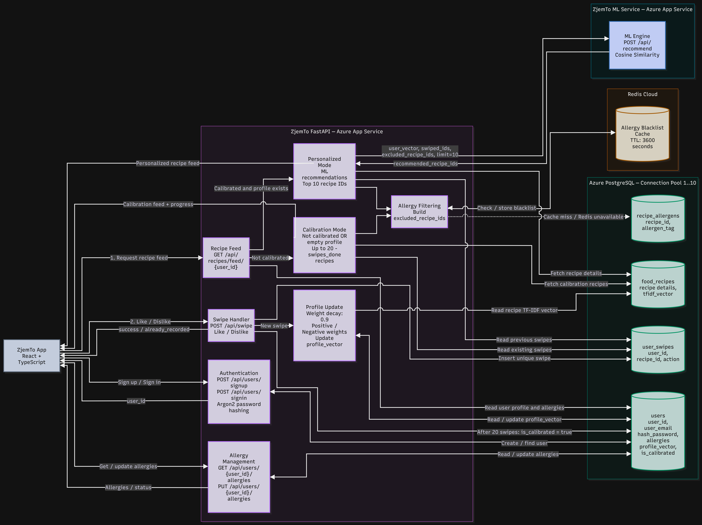

## System Architecture

ZjemTo uses a microservice-based architecture with a FastAPI
backend, a separate ML recommendation engine, Azure PostgreSQL,
and Redis caching.

The system supports:
- User registration and authentication with Argon2
- Recipe calibration and personalized recommendations
- Like/dislike feedback with user profile updates
- Allergy-based recipe filtering
- TF-IDF and cosine similarity for recipe ranking

[View architecture diagram source](docs/architecture.drawio)