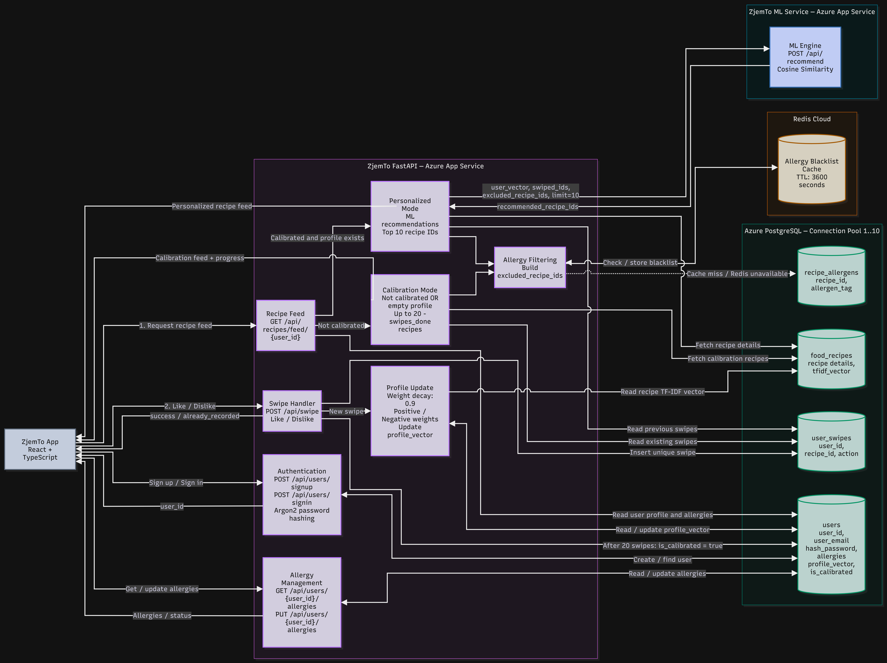

# ZjemTo — Backend API

## Overview

The ZjemTo Backend API is responsible for user management, recipe recommendations, preference learning, allergy filtering and Smart Fridge functionality.

The backend is implemented using FastAPI and communicates with a separate ML recommendation engine, Azure PostgreSQL and Redis.

## System Architecture



[View architecture diagram source](../docs/architecture.drawio)

## Technology Stack

| Technology | Purpose |
|---|---|
| FastAPI | REST API |
| PostgreSQL | Recipe and user data storage |
| Redis | Caching |
| Argon2 | Password hashing |
| Psycopg2 | Database communication and connection pooling |
| TF-IDF | Recipe vector representation |
| Cosine Similarity | Personalized recipe ranking |
| Microsoft Azure | Cloud infrastructure |
| Gunicorn / Uvicorn | Application server |

## Project Structure

```text
ZjemTo-API/
├── main.py
├── database.py
├── schemas.py
├── requirements.txt
├── routers/
│   ├── users.py
│   ├── feed.py
│   ├── fridge.py
│   ├── swipes.py
│   └── favorites.py
└── services/
    ├── ml.py
    ├── recipes.py
    └── allergens.py
```

## Main Features

- User registration and authentication with Argon2.
- Initial preference calibration based on 20 recipe swipes.
- Personalized recipe recommendations.
- Like/dislike feedback and user profile updates.
- Favorite recipe management.
- Allergy-based recipe filtering.
- Smart Fridge recommendations based on available ingredients.

## Recommendation Engine

The recommendation engine operates as a separate service.

Recipes are represented as TF-IDF vectors. User preferences are represented by a profile vector generated from recipe feedback.

Cosine similarity is used to rank recipes according to the user's preferences.

The recommendation engine supports two modes:

| Mode | Description |
|---|---|
| `feed` | Personalized recommendations excluding previously swiped recipes |
| `fridge` | Personalized recommendations restricted to a whitelist of compatible recipes |

## Smart Fridge

Smart Fridge allows users to discover recipes based on ingredients they already have.

The system supports 574 standardized ingredient groups and allows up to two missing ingredient requirements.

### Request Processing

1. Retrieve the user profile and allergy preferences.
2. Validate the selected ingredient group IDs.
3. Find compatible recipes using PostgreSQL.
4. Exclude recipes containing recorded user allergens.
5. Send the complete candidate whitelist to the ML recommendation engine.
6. Rank compatible recipes using cosine similarity.
7. Return recipe details and missing ingredient counts.

Previously swiped recipes are not excluded in Smart Fridge mode.

## Database Optimization

Ingredient normalization is performed offline. The backend does not execute the transformer model during API requests.

Smart Fridge uses two PostgreSQL materialized views:

| Materialized View | Purpose |
|---|---|
| `fridge_recipe_stats` | Precomputed mandatory requirements and recipe eligibility |
| `fridge_requirement_options` | Expanded ingredient alternatives and logical conditions |

Additional optimizations include:

- Composite B-tree indexes.
- Covering indexes for ingredient matching.
- Precomputed AND/OR ingredient requirements.
- Transaction-local `work_mem` configuration.
- Database connection pooling.

These optimizations eliminate repeated JSONB parsing during Smart Fridge requests.

Materialized views must be refreshed when the underlying normalized recipe dataset changes.

## API Endpoints

| Method | Endpoint | Description |
|---|---|---|
| POST | `/api/users/signup` | Register a user |
| POST | `/api/users/signin` | Authenticate a user |
| GET | `/api/users/{user_id}/allergies` | Retrieve user allergies |
| PUT | `/api/users/{user_id}/allergies` | Update user allergies |
| GET | `/api/recipes/feed/{user_id}` | Retrieve recipe recommendations |
| POST | `/api/swipe` | Submit recipe feedback |
| GET | `/api/ingredients/groups` | Retrieve available ingredient groups |
| POST | `/api/recipes/fridge/{user_id}` | Retrieve Smart Fridge recommendations |

### Smart Fridge Request Example

```json
{
    "group_ids": [87, 378, 395, 336, 60],
    "max_missing": 2,
    "limit": 10
}
```

Each returned recipe includes additional information:

- `missing_count` — number of unsatisfied mandatory ingredient requirements.
- `total_required` — total number of mandatory ingredient requirements.

## Running Locally

Install the required dependencies:

```bash
pip install -r requirements.txt
```

Configure the database, Redis and ML service connection settings.

Start the API:

```bash
uvicorn main:app --reload
```

Interactive API documentation is available at:

```text
http://localhost:8000/docs
```

## Deployment

The backend is deployed on Microsoft Azure App Service.

Production startup command:

```bash
gunicorn -w 1 -k uvicorn.workers.UvicornWorker main:app --bind 0.0.0.0:8000 --access-logfile - --error-logfile - --capture-output
```

Database credentials and other sensitive configuration values should be provided through environment variables.

## Related Documentation

- [Data Processing and Ingredient Classification](../data/README.md)
- [Project Overview](../README.md)