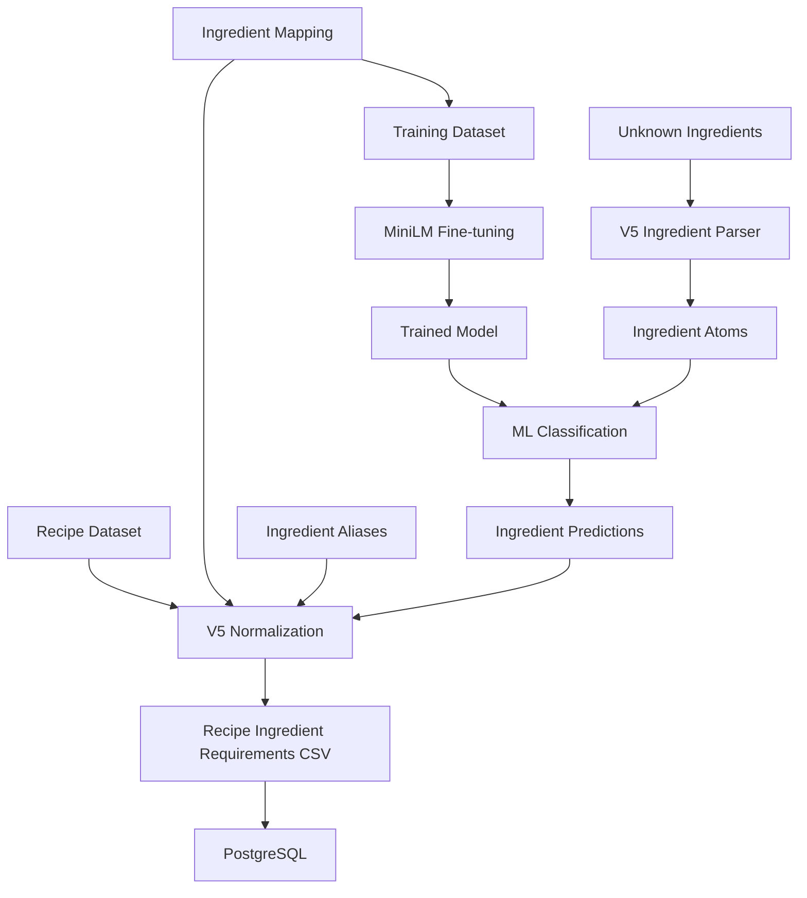

# ZjemTo — Data Processing & Ingredient Classification

## Overview

This module is responsible for offline recipe data processing, ingredient normalization and machine learning-based ingredient classification for the Smart Fridge feature.

The main goal is to transform unstructured ingredient descriptions into standardized product groups and logical requirements that can be efficiently processed by PostgreSQL.

## Dataset

| Parameter | Value |
|---|---:|
| Recipes | 522,207 |
| Ingredient records | 4,878,297 |
| Base ingredient groups | 574 |
| ML classification classes | 452 |
| Labelled training dataset | 71,952 |

## Main Scripts

| Script | Responsibility |
|---|---|
| `training/train_bert_v2.py` | Fine-tuning and evaluation of the ingredient classification model |
| `predict_ingredient_bert.py` | Classification of unknown ingredients using the trained model |
| `rebuild_ingredient_requirements_v5.py` | Ingredient normalization, logical parsing and final dataset generation |

## Ingredient Normalization

The normalization pipeline combines several approaches:

- Exact dictionary matching.
- Text normalization and alias matching.
- Rule-based ingredient parsing.
- Transformer-based ingredient classification.
- Confidence-based prediction filtering.

Complex ingredient descriptions are represented using logical AND/OR requirements.

Examples:

| Ingredient | Group requirements |
|---|---|
| Chicken | `[[87]]` |
| Butter or margarine | `[[60,282]]` |
| Salt and pepper | `[[395],[336]]` |

The outer array represents AND conditions, while the inner arrays represent OR alternatives.

Optional ingredients are excluded from mandatory recipe requirements. Unresolved single ingredients are treated as missing requirements, while unresolved mandatory complex expressions block recipe eligibility.

## Machine Learning Model

The ingredient classifier is based on the pretrained `sentence-transformers/all-MiniLM-L6-v2` transformer model, fine-tuned for single-label ingredient classification.

### Training Configuration

| Parameter | Value |
|---|---|
| Maximum epochs | 8 |
| Batch size | 32 |
| Learning rate | 2e-5 |
| Maximum sequence length | 64 |
| Optimizer | AdamW |
| Loss function | Weighted Cross-Entropy |
| Class weight power | 0.5 |
| Early stopping patience | 2 |
| Model selection metric | Macro F1 |
| Random seed | 42 |

### Model Evaluation

Both model versions were evaluated using the same dataset splits.

| Metric | V1 | V2 |
|---|---:|---:|
| Accuracy | 90.85% | 95.79% |
| Macro F1 | 37.24% | 53.11% |
| Weighted F1 | 87.66% | 94.15% |
| Top-3 Accuracy | 95.29% | 97.76% |

The majority-class baseline accuracy is approximately 7.18%.

Predictions are accepted only when they satisfy the configured confidence and margin thresholds.

The reported evaluation metrics refer to the labelled test dataset, not previously unseen and unlabelled ingredient descriptions.

## Processing Pipeline



## Normalization Results

| Metric | Count |
|---|---:|
| Processed recipes | 522,207 |
| Generated ingredient records | 4,878,297 |
| Fully resolved required ingredients per recipe | 112,725 recipes |
| Potentially eligible recipes with up to one unresolved requirement | 165,306 |
| Potentially eligible recipes with up to two unresolved requirements | 181,076 |
| Recipes containing blocked mandatory requirements | 335,903 |

Potential eligibility does not guarantee that a recipe matches the ingredients available in a specific user's fridge.

## Running the Pipeline

Run the following commands from the `data` directory.

### 1. Train the model (optional)

```bash
python training/train_bert_v2.py
```

New training results are stored in `training_run/`. The existing model is preserved.

### 2. Prepare unknown ingredient atoms

```bash
python rebuild_ingredient_requirements_v5.py prepare
```

Output:

```text
output/atoms.csv
```

### 3. Classify ingredients

```bash
python predict_ingredient_bert.py
```

The prediction script uses the trained model stored in `model/`.

Output:

```text
output/bert_predictions.csv
```

### 4. Generate recipe ingredient requirements

```bash
python rebuild_ingredient_requirements_v5.py rebuild
```

Output:

```text
output/recipe_ingredient_requirements_v5.csv
```

The required source CSV files, trained model and Python dependencies must be available locally before running the pipeline.

If a new model has been trained, its weights must be selected explicitly or copied into the active `model/` directory before classification.

## PostgreSQL Integration

The final dataset is imported into PostgreSQL.

Smart Fridge queries use two materialized views:

- `fridge_recipe_stats`
- `fridge_requirement_options`

These views precompute recipe statistics and expand logical ingredient requirements into indexed relational records.

This eliminates repeated JSONB parsing during API requests.

The database filters recipes according to available ingredients, missing requirements and recorded allergen tags. The resulting recipe IDs are passed to the recommendation engine as a whitelist for personalized ranking.

## Limitations

- The classifier supports a fixed set of ingredient classes.
- Some ingredient descriptions are ambiguous or contain complex logical expressions.
- Model confidence does not guarantee prediction correctness.
- Ingredient classification and allergen metadata are not a guarantee of food allergy safety.
- Materialized views must be refreshed after changes to the normalized dataset.

All model training and ingredient classification are performed offline. The deployed API does not need to execute the transformer model during Smart Fridge requests.