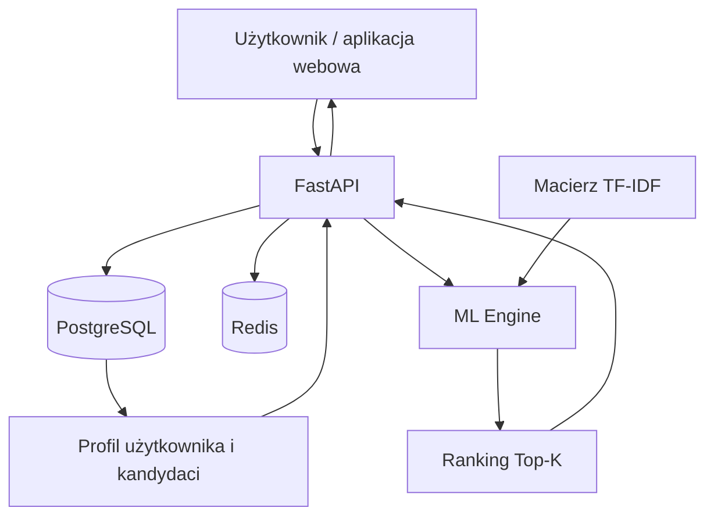

# ZjemTo — Intelligent Recipe Recommendation System

**Zespół:** Z2 · grupa L2 · **Repozytorium:** [Aspirinder/zjemto-recipe-recommender](https://github.com/Aspirinder/zjemto-recipe-recommender)
Sztuczna inteligencja — laboratorium · Collegium Da Vinci · rok akad. 2026/2027

## 1. Problem *(rubryka A)*

ZjemTo jest aplikacją dla osób, które szukają pomysłów na posiłki, chcą uwzględnić własne preferencje kulinarne i ograniczyć marnowanie żywności. Przeglądanie dużego katalogu przepisów zajmuje czas, a uniwersalna lista popularnych dań nie uwzględnia indywidualnego gustu. Użytkownik ocenia przepisy za pomocą gestów like/dislike, określa alergie i może wybrać produkty dostępne w domu. System na tej podstawie buduje profil preferencji i zwraca uporządkowaną listę dopasowanych przepisów. Funkcja Smart Fridge pozwala dodatkowo znaleźć dania, w których brakuje najwyżej dwóch obowiązkowych wymagań składnikowych.

## 2. Dlaczego SI i dlaczego ta technika *(B · 7 pkt)*

Gust kulinarny jest indywidualny i zmienia się z czasem. Trudno opisać go za pomocą ręcznie przygotowanych reguł,
ponieważ użytkownik może lubić określone połączenia składników, kategorie lub rodzaje dań, a nie tylko pojedyncze produkty.

Wybraliśmy filtrowanie treściowe (content-based filtering) z reprezentacją TF-IDF i podobieństwem kosinusowym. Metoda pozwala porównywać profil użytkownika z opisami przepisów w tej samej przestrzeni cech i aktualizować profil po każdej nowej ocenie.Nie wymaga dużej liczby interakcji innych użytkowników aplikacji. 
Ranking według popularności nie zapewnia indywidualnego dopasowania, natomiast filtrowanie kolaboracyjne wymagałoby odpowiednio bogatej historii interakcji użytkowników.

## 3. Dane *(B · 8 pkt)*

Źródło: [Food.com Recipes and Reviews — Kaggle](https://www.kaggle.com/datasets/irkaal/foodcom-recipes-and-reviews).

| Dane | Rozmiar / format |
|---|---|
| Przepisy (`recipes.csv`) | 522 517 rekordów, CSV |
| Recenzje (`reviews.csv`) | 1 401 982 rekordy, CSV |
| Macierz `X_tfidf.npz` w eksperymencie | 522 517 × 15 000, 20 423 323 niezerowe wartości |
| Dane przetworzone dla Smart Fridge | 522 207 przepisów, 4 878 297 rekordów wymagań składnikowych |
| Grupy produktów Smart Fridge | 574 |

Dane przepisów zawierają m.in. nazwy, kategorie, słowa kluczowe, składniki, ilości, instrukcje, zdjęcia, czasy przygotowania i wartości odżywcze.

Podczas analizy oryginalnego zbioru danych wykryto liczne problemy związane z jakością i kompletnością danych. Część rekordów zawierała brakujące wartości, niepoprawnie zapisane informacje oraz niespójności w strukturze danych. W celu poprawy jakości zbioru przeprowadzono dodatkowy web scraping serwisu Food.com, pozyskując brakujące informacje bezpośrednio ze stron przepisów. Następnie oczyszczono teksty i listy zapisane w składni R, obsłużono brakujące wartości, usunięto niepoprawne rekordy oraz ujednolicono nazwy składników.

Do wektoryzacji wykorzystano kategorie, słowa kluczowe i oczyszczone składniki. Przetworzone przepisy przeniesiono do PostgreSQL, zachowując zgodność identyfikatorów z wierszami odpowiedniej macierzy TF-IDF.


## 4. Rozwiązanie *(A · 10 pkt, B · 5 pkt)*

### Architektura i przepływ danych

Aplikacja React + TypeScript komunikuje się z głównym API FastAPI. API korzysta z PostgreSQL na Azure, Redis Cloud i osobnego serwisu ML Engine. Frontend działa na GitHub Pages, a oba serwisy API na Azure App Service.



1. Nowy użytkownik ocenia 20 przepisów w ramach kalibracji profilu.
2. API zapisuje oceny i aktualizuje wektor preferencji. Starsze wagi są stopniowo wygaszane.
3. Po kalibracji API przekazuje profil do ML Engine wraz z ograniczeniami odpowiednimi dla trybu rekomendacji.
4. ML Engine oblicza podobieństwo, wybiera najlepszych kandydatów i zwraca ich identyfikatory.
5. API pobiera szczegóły przepisów i zwraca JSON do aplikacji.
6. W trybie Smart Fridge PostgreSQL najpierw wybiera przepisy pasujące do produktów i filtruje oznaczone alergeny. ML Engine porządkuje tylko tę listę kandydatów. W tym trybie wcześniej ocenione przepisy pozostają dostępne.

### Reprezentacja TF-IDF

Waga cechy zależy od jej występowania w danym przepisie i częstości w całym katalogu. Dla wygładzonej postaci IDF:

$$
\mathrm{tfidf}(t,d)=\mathrm{tf}(t,d)\left(\ln\frac{1+N}{1+\mathrm{df}(t)}+1\right)
$$

Gdzie $t$ to cecha tekstowa, $d$ — przepis, $N$ — liczba przepisów, a $\mathrm{df}(t)$ — liczba przepisów zawierających cechę. Wagi są normalizowane do normy L2 równej 1 dla niezerowych wektorów. Cechy charakterystyczne dla dania mają większe znaczenie niż słowa występujące w większości przepisów.

### Profil użytkownika i ranking

W eksperymencie profil jest znormalizowaną sumą wektorów ocenionych przepisów:

$$
u=\sum_{i\in L}x_i-0.3\sum_{j\in D}x_j,\qquad \hat u=\frac{u}{\lVert u\rVert_2}
$$

Gdzie $L$ oznacza polubione przepisy, $D$ odrzucone, a $x_i$ ich wektory TF-IDF. W aplikacji profil jest aktualizowany na bieżąco: dotychczasowe wagi są mnożone przez 0,9, polubienia wzmacniają cechy, a odrzucenia je osłabiają. Mechanizm aktualizacji wdrożonego profilu nie jest identyczny z uproszczonym profilem użytym w notebooku ewaluacyjnym.

Funkcja oceny przepisu:

$$
s(u,x_i)=\cos(u,x_i)=\frac{u\cdot x_i}{\lVert u\rVert_2\lVert x_i\rVert_2}
$$

Im wyższa wartość, tym większa zgodność przepisu z profilem. Dla znormalizowanych wektorów obliczenie sprowadza się do iloczynu skalarnego. ML Engine wykorzystuje rzadką macierz SciPy, mnożenie macierzy przez wektor i `numpy.argpartition` do wyboru Top-K bez sortowania całego katalogu.

| Parametr | Wartość |
|---|---|
| Liczba cech TF-IDF | maks. 15 000 |
| N-gramy | 1–2 |
| Kalibracja | 20 ocen |
| Wygaszanie profilu w aplikacji | 0,9 na aktualizację |
| Wagi w eksperymencie | +1 / −0,3 |

### Smart Fridge

Dopasowanie składników jest przygotowywane offline: słowniki, aliasy, reguły i klasyfikacja tekstu pozwalają zamienić opisy na grupy produktów. Alternatywy i koniunkcje zapisuje się jako wymagania AND/OR. Przykładowo `[[60,282]]` oznacza masło lub margarynę, a `[[395],[336]]` oznacza sól i pieprz. Opcjonalne składniki nie zwiększają liczby obowiązkowych wymagań; nierozwiązane złożone wymagania obowiązkowe blokują kwalifikację przepisu.

Widoki zmaterializowane `fridge_recipe_stats` i `fridge_requirement_options` przechowują wcześniej obliczone statystyki i rozłożone warunki składnikowe. Zapytanie korzysta z indeksów, liczy spełnione wymagania, odejmuje je od liczby obowiązkowych wymagań i odrzuca przepisy z oznaczonymi alergenami użytkownika. Pełna lista pasujących identyfikatorów trafia do ML Engine. Szczegółowy opis przetwarzania danych znajduje się w [data-in-DB/README.md](../data-in-DB/README.md), a API w [ZjemTo-API/README.md](../ZjemTo-API/README.md).

## 5. Ewaluacja *(B · 8 pkt)*

Wstępnie w karcie projektu przewidziano RMSE. Ostateczny algorytm zwraca ranking, a nie przewidywane oceny liczbowe, dlatego zastosowano metryki dopasowania i właściwości list rekomendacji. Porównano trzy metody na tych samych 150 profilach i z wykluczeniem przepisów wcześniej ocenionych przez danego autora:

- **Most Popular (baseline)** — ranking według liczby pozytywnych ocen.
- **Binary Jaccard** — podobieństwo zbiorów cech przepisu i dodatnich cech profilu, $J(A,B)=|A\cap B|/|A\cup B|$.
- **TF-IDF + Cosine** — nasza metoda, uwzględniająca wagi cech i kierunek preferencji.

| Przypadek / zbiór (150 profili, Top-10) | Punkt odniesienia: Most Popular | Binary Jaccard | Nasz system: TF-IDF + Cosine |
|---|---:|---:|---:|
| Średnie podobieństwo do profilu | 0,1136 | 0,3012 | **0,3936** |
| Nowość (novelty) | 10,3585 | 19,2025 | **19,2689** |
| Zróżnicowanie listy (ILD) | **0,9365** | 0,7550 | 0,6196 |
| Unikalne polecone przepisy | 13 | 1 101 | **1 376** |
| Pokrycie katalogu | 0,0025% | 0,2107% | **0,2633%** |
| Mediana czasu | **0,0103 ms** | 16,2288 ms | 14,5049 ms |
| 95. percentyl czasu | **0,0265 ms** | 25,8092 ms | 23,8120 ms |

Średnie podobieństwo oznacza średnią wartość cosinusa dla Top-10; ILD to 1 minus średnie podobieństwo par przepisów na liście. Nowość mierzy rzadkość poleconych przepisów na podstawie wygładzonej popularności ($-\log_2 p$), a pokrycie — udział unikalnych poleconych przepisów w katalogu.

Nasz model uzyskał podobieństwo do profilu wyższe o 0,2800 od Most Popular i o 0,0924 od Binary Jaccard, oraz największe pokrycie katalogu i nowość. Kosztem większego dopasowania jest mniejsze zróżnicowanie pojedynczej listy. Podobieństwo kosinusowe jest równocześnie funkcją celu rankingu TF-IDF, dlatego nie jest niezależnym dowodem trafności przyszłych rekomendacji.

Źródło wyników: zapisane wykonanie `test.ipynb`.

## 6. Wymagania niefunkcjonalne *(A · 5 pkt)*

**Wydajność:** lokalny benchmark `test.ipynb` wykorzystuje `time.perf_counter()` do pomiaru rankingu Top-10. Mediana wynosi 14,5 ms, a 95. percentyl 23,8 ms, co spełnia lokalny cel poniżej 1 s. Pomiar nie obejmuje budowy profilu, uruchomienia serwera, sieci, PostgreSQL ani renderowania strony. Zapytanie Smart Fridge sprawdzano również w PostgreSQL; w jednym teście z 17 produktami i filtracją alergenów trwało około 0,83 s, co nie jest czasem całego żądania HTTP.

**Obsługa błędów:** API waliduje dane wejściowe, zwraca 404 dla nieistniejącego użytkownika, 409 przy braku kalibracji, 422 dla błędnych danych i 503 przy niedostępności ML Engine. Brak kandydatów daje pustą listę. Niedostępność Redis powoduje przejście do zapytań do bazy. Hasła są haszowane przez Argon2.

**Powtarzalność:** losowanie 150 profili używa ziarna 42. Przy tej samej macierzy, danych i konfiguracji ranking powinien być powtarzalny, z możliwymi różnicami przy remisach lub zmianie środowiska numerycznego. Czasy wykonania mogą się różnić. Kalibracja aplikacji wykorzystuje losowy wybór przepisów, a stan profilu zależy od kolejności ocen.

## 7. Ograniczenia *(E · 4 pkt)*

- Filtrowanie treściowe preferuje dania podobne do już lubianych. Osoba lubiąca kurczaka może otrzymywać wiele podobnych propozycji zamiast odkrywać inne kuchnie.
- Na początku brakuje historii użytkownika, dlatego konieczna jest kalibracja.
- Znaczniki alergenów nie gwarantują bezpieczeństwa osobom z alergiami; użytkownik powinien sam zweryfikować skład.
- Darmowy plan Azure może powodować opóźnienie pierwszego żądania po okresie bezczynności. Widoki zmaterializowane wymagają odświeżenia po zmianie danych.
- Ewaluacja nie mierzy przewidywania przyszłych ocen. Kolejny krok to podział chronologiczny historii, niezależny zbiór testowy i metryki Recall@10 oraz NDCG@10. Można też dodać element eksploracji, ponowne szeregowanie dla różnorodności i prezentację nazw brakujących produktów.

TF-IDF i filtrowanie treściowe nadal są użyteczne, zwłaszcza jako szybkie, interpretowalne metody bazowe. W bardziej rozbudowanych systemach stosuje się też embeddingi neuronowe, filtrowanie kolaboracyjne i rozwiązania hybrydowe. Nie oznacza to, że klasyczna metoda jest nieprzydatna.

## 8. Zastosowania w praktyce *(E · 4 pkt)*

ZjemTo przenosi tę ideę na wybór posiłków. Połączenie rankingu preferencji i ograniczeń dotyczących dostępnych produktów ma praktyczne zastosowanie w planowaniu posiłków, wykorzystywaniu zapasów i ograniczaniu marnowania żywności.

Systemy rekomendacyjne wykorzystuje się w handlu internetowym, serwisach multimedialnych i aplikacjach kulinarnych, aby ograniczyć czas wyszukiwania i dopasować ofertę do preferencji. Przykładem zastosowania filtrowania treściowego jest opis rekomendowania aplikacji w Google Play na podstawie cech produktów i interakcji użytkownika.

## 9. Zespół *(D · 8 pkt)*

| Osoba | Za co odpowiadała |
|---|---|
| Yahor Koval (31028) | Koordynacja, algorytmy rekomendacji, TF-IDF, ML Engine, porównanie metod i wdrożenie serwisu ML na Azure. |
| Anton Talmachou (31145) | Przygotowanie danych, PostgreSQL, główne API, kalibracja i aktualizacja profilu, alergie, Redis, normalizacja składników i Smart Fridge. |
| Sofiya Krasouskaya (30999) | Aplikacja webowa React + TypeScript, integracja z API, wdrożenie frontendu i dokumentacja. |

## 10. Uruchomienie *(C · 4 pkt)*

Najprostszy sposób uruchomienia nie wymaga instalacji:

- Aplikacja: <https://mulatkasofi.github.io/zjemto/>
- Dokumentacja REST API: <https://zjemto-api.azurewebsites.net/docs>

Użytkownik zakłada konto, ocenia 20 przepisów i otrzymuje spersonalizowaną talię. Może także przejść do Smart Fridge, wybrać produkty i dopuszczalną liczbę brakujących wymagań. Wyniki pojawiają się w interfejsie. Dostępny jest też tryb demo z przykładowymi przepisami bez konta.

### Uruchomienie głównego API lokalnie

Wymagania: Python 3.11, dostęp do przygotowanej bazy PostgreSQL i działającego ML Engine z odpowiednią macierzą TF-IDF, konfiguracja zmiennych środowiskowych zgodna z kodem. Redis jest opcjonalny dla działania bez pamięci podręcznej.

```bash
git clone https://github.com/Aspirinder/zjemto-recipe-recommender.git
cd zjemto-recipe-recommender/ZjemTo-API
pip install -r requirements.txt
python -m uvicorn main:app --port 8000
```

Wyniki w JSON można sprawdzić pod `http://localhost:8000/docs`, wywołując endpointy rejestracji, kalibracji i rekomendacji. Szczegóły: [README API](../ZjemTo-API/README.md).

## 11. Narzędzia AI

Korzystaliśmy z ChatGPT jako narzędzia wspomagającego programowanie, analizę błędów, refaktoryzację kodu Python, projektowanie i optymalizację zapytań SQL. 
Narzędzie wspierało również analizę i przetwarzanie zbioru danych, normalizację składników, przygotowanie danych treningowych 
oraz dostrajanie (fine-tuning) modelu MiniLM opartego na architekturze BERT.
