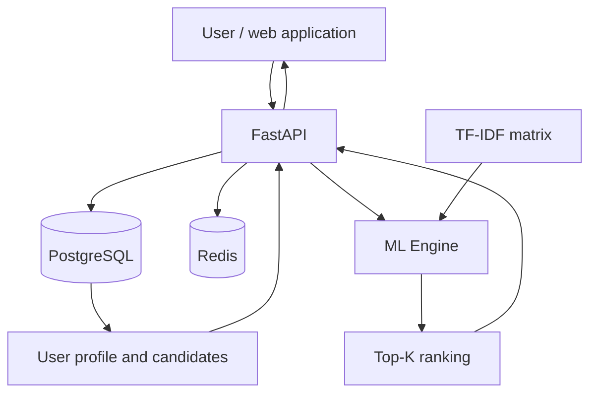

# ZjemTo — Intelligent Recipe Recommendation System

**Team:** Z2 · group L2 · **Repository:** [Aspirinder/zjemto-recipe-recommender](https://github.com/Aspirinder/zjemto-recipe-recommender)
Artificial Intelligence — laboratory · Collegium Da Vinci · academic year 2026/2027

## 1. Problem *(rubric A)*

ZjemTo is an application for people who are looking for meal ideas, want to take their own culinary preferences into account and reduce food waste. Browsing a large recipe catalogue takes time, and a universal list of popular dishes does not account for individual tastes. Users rate recipes using like/dislike gestures, specify their allergies and can select products available at home. Based on this information, the system builds a preference profile and returns a ranked list of matching recipes. The Smart Fridge feature also makes it possible to find dishes with at most two missing mandatory ingredient requirements.

## 2. Why AI and why this technique *(B · 7 points)*

Culinary taste is individual and changes over time. It is difficult to describe using manually prepared rules,
because users may like particular combinations of ingredients, categories or types of dishes, rather than just individual products.

We chose content-based filtering with TF-IDF representation and cosine similarity. This method makes it possible to compare the user profile with recipe descriptions in the same feature space and update the profile after each new rating. It does not require a large number of interactions from other application users.
Popularity-based ranking does not provide individual matching, while collaborative filtering would require a sufficiently rich history of user interactions.

## 3. Data *(B · 8 points)*

Source: [Food.com Recipes and Reviews — Kaggle](https://www.kaggle.com/datasets/irkaal/foodcom-recipes-and-reviews).

| Data | Size / format |
|---|---|
| Recipes (`recipes.csv`) | 522,517 records, CSV |
| Reviews (`reviews.csv`) | 1,401,982 records, CSV |
| `X_tfidf.npz` matrix in the experiment | 522,517 × 15,000, 20,423,323 non-zero values |
| Data processed for Smart Fridge | 522,207 recipes, 4,878,297 ingredient requirement records |
| Smart Fridge product groups | 574 |

Recipe data includes names, categories, keywords, ingredients, quantities, instructions, images, preparation times and nutritional values, among other things.

During the analysis of the original dataset, numerous issues related to data quality and completeness were identified. Some records contained missing values, incorrectly formatted information and inconsistencies in the data structure. To improve the quality of the dataset, additional web scraping of Food.com was carried out, obtaining missing information directly from recipe pages. The texts and lists written in R syntax were then cleaned, missing values were handled, invalid records were removed and ingredient names were standardised.

Categories, keywords and cleaned ingredients were used for vectorisation. The processed recipes were transferred to PostgreSQL, maintaining the correspondence between identifiers and the rows of the relevant TF-IDF matrix.


## 4. Solution *(A · 10 points, B · 5 points)*

### Architecture and data flow

The React + TypeScript application communicates with the main FastAPI API. The API uses PostgreSQL on Azure, Redis Cloud and a separate ML Engine service. The frontend runs on GitHub Pages, while both API services run on Azure App Service.



1. A new user rates 20 recipes as part of profile calibration.
2. The API records the ratings and updates the preference vector. Older weights gradually decay.
3. After calibration, the API passes the profile to the ML Engine along with the constraints appropriate to the recommendation mode.
4. The ML Engine calculates similarity, selects the best candidates and returns their identifiers.
5. The API retrieves recipe details and returns JSON to the application.
6. In Smart Fridge mode, PostgreSQL first selects recipes matching the available products and filters out flagged allergens. The ML Engine ranks only this list of candidates. Previously rated recipes remain available in this mode.

### TF-IDF representation

The weight of a feature depends on its occurrence in a given recipe and its frequency throughout the catalogue. For the smoothed form of IDF:

$$
\operatorname{tfidf}(t,d)=\operatorname{tf}(t,d)\left(\ln\frac{1+N}{1+\operatorname{df}(t)}+1\right)
$$

Where $t$ is a textual feature, $d$ is a recipe, $N$ is the number of recipes, and $\operatorname{df}(t)$ is the number of recipes containing the feature. The weights are normalised so that non-zero vectors have an L2 norm of 1. Features characteristic of a dish are more significant than words occurring in most recipes.

### User profile and ranking

In the experiment, the profile is a normalised sum of the vectors of rated recipes:

$$
u=\sum_{i\in L}x_i-0.3\sum_{j\in D}x_j,\qquad \hat u=\frac{u}{\lVert u\rVert_2}
$$

Where $L$ denotes liked recipes, $D$ denotes rejected recipes, and $x_i$ denotes their TF-IDF vectors. In the application, the profile is updated continuously: existing weights are multiplied by 0.9, likes strengthen features, and dislikes weaken them. The update mechanism of the deployed profile is not identical to the simplified profile used in the evaluation notebook.

Recipe scoring function:

$$
s(u,x_i)=\cos(u,x_i)=\frac{u\cdot x_i}{\lVert u\rVert_2\lVert x_i\rVert_2}
$$

The higher the value, the better the recipe matches the profile. For normalised vectors, the calculation reduces to a dot product. The ML Engine uses a SciPy sparse matrix, matrix-vector multiplication and `numpy.argpartition` to select the Top-K without sorting the entire catalogue.

| Parameter | Value |
|---|---|
| Number of TF-IDF features | max. 15,000 |
| N-grams | 1–2 |
| Calibration | 20 ratings |
| Profile decay in the application | 0.9 per update |
| Weights in the experiment | +1 / −0.3 |

### Smart Fridge

Ingredient matching is prepared offline: dictionaries, aliases, rules and text classification make it possible to convert descriptions into product groups. Alternatives and conjunctions are represented as AND/OR requirements. For example, `[[60,282]]` means butter or margarine, and `[[395],[336]]` means salt and pepper. Optional ingredients do not increase the number of mandatory requirements; unresolved complex mandatory requirements prevent a recipe from qualifying.

The materialized views `fridge_recipe_stats` and `fridge_requirement_options` store precomputed statistics and expanded ingredient conditions. The query uses indexes, counts satisfied requirements, subtracts them from the number of mandatory requirements and excludes recipes with flagged user allergens. The complete list of matching identifiers is passed to the ML Engine. A detailed description of data processing can be found in [data-in-DB/README.md](../data-in-DB/README.md), and the API description in [ZjemTo-API/README.md](../ZjemTo-API/README.md).

## 5. Evaluation *(B · 8 points)*

RMSE was initially planned in the project proposal. The final algorithm returns a ranking rather than predicted numerical ratings, so metrics measuring profile alignment and recommendation list properties were used. Three methods were compared on the same 150 profiles, excluding recipes previously rated by the respective reviewer:

- **Most Popular (baseline)** — ranking by the number of positive ratings.
- **Binary Jaccard** — similarity between the sets of recipe features and positive profile features, $J(A,B)=|A\cap B|/|A\cup B|$.
- **TF-IDF + Cosine** — our method, which takes feature weights and the direction of preferences into account.

| Case / dataset (150 profiles, Top-10) | Baseline: Most Popular | Binary Jaccard | Our system: TF-IDF + Cosine |
|---|---:|---:|---:|
| Mean similarity to the profile | 0.1136 | 0.3012 | **0.3936** |
| Novelty | 10.3585 | 19.2025 | **19.2689** |
| Intra-list diversity (ILD) | **0.9365** | 0.7550 | 0.6196 |
| Unique recommended recipes | 13 | 1,101 | **1,376** |
| Catalogue coverage | 0.0025% | 0.2107% | **0.2633%** |
| Median latency | **0.0103 ms** | 16.2288 ms | 14.5049 ms |
| 95th percentile latency | **0.0265 ms** | 25.8092 ms | 23.8120 ms |

Mean similarity refers to the average cosine similarity for the Top-10; ILD is 1 minus the average pairwise similarity of recipes in the list. Novelty measures the rarity of recommended recipes based on smoothed popularity ($-\log_2 p$), while coverage measures the proportion of unique recommended recipes in the catalogue.

Our model achieved a profile similarity 0.2800 higher than Most Popular and 0.0924 higher than Binary Jaccard, as well as the highest catalogue coverage and novelty. The trade-off for better matching is lower diversity within an individual list. Cosine similarity is also the objective function of the TF-IDF ranking, so it is not independent evidence of the accuracy of future recommendations.

Source of results: saved execution of `test.ipynb`.

## 6. Non-functional requirements *(A · 5 points)*

**Performance:** the local benchmark `test.ipynb` uses `time.perf_counter()` to measure Top-10 ranking. The median is 14.5 ms and the 95th percentile is 23.8 ms, meeting the local target of less than 1 s. The measurement does not include profile construction, server startup, network communication, PostgreSQL or page rendering. The Smart Fridge query was also tested in PostgreSQL; in one test with 17 products and allergen filtering, it took approximately 0.83 s, which is not the duration of the entire HTTP request.

**Error handling:** the API validates input data and returns 404 for a non-existent user, 409 when calibration is incomplete, 422 for invalid data and 503 when the ML Engine is unavailable. If there are no candidates, an empty list is returned. If Redis is unavailable, the system falls back to database queries. Passwords are hashed using Argon2.

**Reproducibility:** the random selection of 150 profiles uses seed 42. With the same matrix, data and configuration, the ranking should be reproducible, with possible differences in the event of ties or changes in the numerical environment. Execution times may vary. Application calibration uses random recipe selection, and the profile state depends on the order of ratings.

## 7. Limitations *(E · 4 points)*

- Content-based filtering favours dishes similar to those already liked. A person who likes chicken may receive many similar suggestions instead of discovering other cuisines.
- Initially, there is no user history, so calibration is necessary.
- Allergen tags do not guarantee safety for people with allergies; users should verify the ingredients themselves.
- The free Azure plan may cause a delay in the first request after a period of inactivity. Materialized views need to be refreshed after data changes.
- The evaluation does not measure the prediction of future ratings. The next step is a chronological split of the history, an independent test set and the Recall@10 and NDCG@10 metrics. An exploration component, re-ranking for diversity and the display of missing product names could also be added.

TF-IDF and content-based filtering remain useful, especially as fast, interpretable baseline methods. More advanced systems also use neural embeddings, collaborative filtering and hybrid solutions. This does not mean that the classical method is no longer useful.

## 8. Practical applications *(E · 4 points)*

ZjemTo applies this idea to meal selection. Combining preference-based ranking with constraints related to available products has practical applications in meal planning, making use of existing supplies and reducing food waste.

Recommendation systems are used in e-commerce, multimedia services and cooking applications to reduce search time and match offers to preferences. An example of content-based filtering is the described approach to recommending applications in Google Play based on product features and user interactions.

## 9. Team *(D · 8 points)*

| Person | Responsibilities |
|---|---|
| Yahor Koval (31028) | Coordination, recommendation algorithms, TF-IDF, ML Engine, comparison of methods and deployment of the ML service on Azure. |
| Anton Talmachou (31145) | Data preparation, PostgreSQL, main API, calibration and profile updates, allergies, Redis, ingredient normalisation and Smart Fridge. |
| Sofiya Krasouskaya (30999) | React + TypeScript web application, API integration, frontend deployment and documentation. |

## 10. How to run *(C · 4 points)*

The simplest way to run the application does not require installation:

- Application: <https://mulatkasofi.github.io/zjemto/>
- REST API documentation: <https://zjemto-api.azurewebsites.net/docs>

The user creates an account, rates 20 recipes and receives a personalised deck. They can also open Smart Fridge, select products and specify the allowed number of missing requirements. The results appear in the interface. A demo mode with sample recipes is also available without an account.

### Running the main API locally

Requirements: Python 3.11, access to a prepared PostgreSQL database and a running ML Engine with the appropriate TF-IDF matrix, and environment variable configuration consistent with the code. Redis is optional when running without caching.

```bash
git clone https://github.com/Aspirinder/zjemto-recipe-recommender.git
cd zjemto-recipe-recommender/ZjemTo-API
pip install -r requirements.txt
python -m uvicorn main:app --port 8000
```

JSON results can be checked at `http://localhost:8000/docs` by calling the registration, calibration and recommendation endpoints. Details: [API README](../ZjemTo-API/README.md).

## 11. AI tools

We used ChatGPT as a tool to support programming, error analysis, Python code refactoring, and the design and optimization of SQL queries. The tool also assisted with dataset analysis and processing, ingredient normalization, training data preparation, and fine-tuning the MiniLM model based on the BERT architecture.
